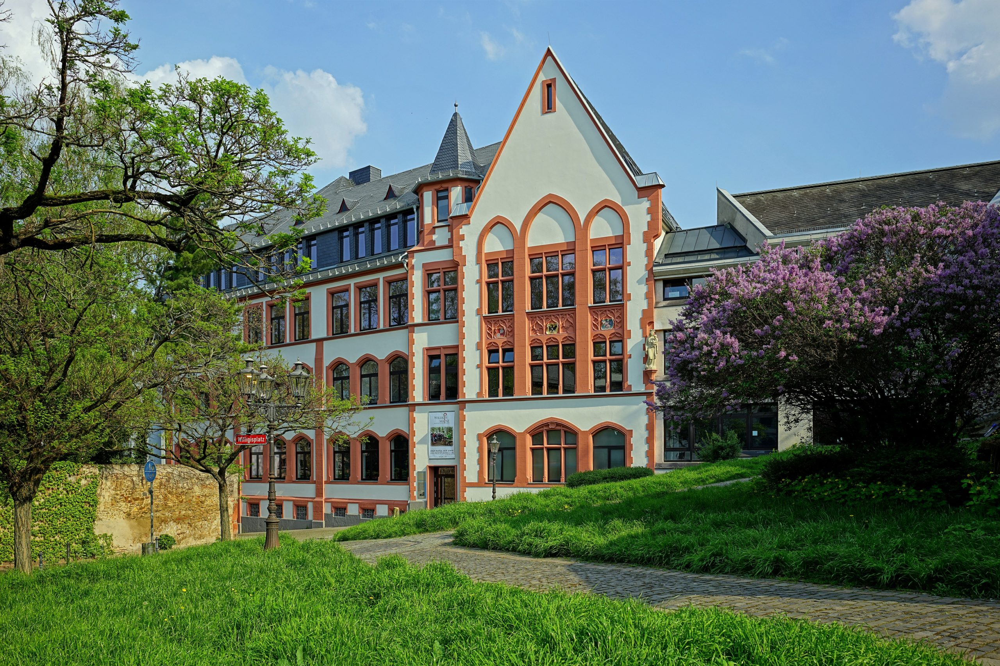

  
  <h1>Bischöfliche Willigis-Schulen</h1>
  
<strong>Tradition bewahren. Zukunft gestalten.</strong>

  
Gymnasium &amp; Realschule · Mainz, Rheinland-Pfalz

  
  
  

---

## Willkommen am Willigis

Die **Bischöflichen Willigis-Schulen Mainz** verbinden christliche Werte, eine lebendige Schulgemeinschaft und moderne Bildung.

Unsere GitHub-Organisation bietet Raum für digitale Ideen, technische Projekte und gemeinsame Softwareentwicklung. Wir möchten Technologie nicht nur nutzen, sondern sie verstehen, entwickeln und verantwortungsvoll gestalten.

## Unsere Schwerpunkte

<table>
  <tr>
    <td width="50%" valign="top">
      <h3>💻 Softwareentwicklung</h3>
      
Digitale Werkzeuge, Anwendungen und technische Lösungen für den Schulalltag.

      <a href="https://github.com/orgs/Bischofliche-Willigis-Schulen/repositories">Projekte entdecken →</a>
    </td>
    <td width="50%" valign="top">
      <h3>🎓 Digitale Bildung</h3>
      
Medienkompetenz und ein verantwortungsvoller Einsatz digitaler Technologien.

      <a href="https://www.willigis-online.de/profile/digitale-schule/">Digitale Schule →</a>
    </td>
  </tr>
  <tr>
    <td width="50%" valign="top">
      <h3>🤖 Informatik &amp; MINT</h3>
      
Programmierung, Robotik und kreative Projekte – vom Algorithmus zur Anwendung.

      <a href="https://www.willigis-online.de/profile/mint/informatik/">Informatik am Willigis →</a>
    </td>
    <td width="50%" valign="top">
      <h3>🤝 Zusammenarbeit</h3>
      
Ideen teilen, voneinander lernen und gemeinsam digitale Lösungen gestalten.

      <a href="https://www.willigis-online.de/kontakt/">Kontakt zur Schule →</a>
    </td>
  </tr>
</table>

## Projekte & Repositories

Hier ist Platz für Quellcode, technische Dokumentationen und Projekte rund um die digitale Welt am Willigis. Informationen zur Nutzung, Mitwirkung und Lizenzierung stehen in den jeweiligen Repositories.

  

## Gemeinsam entwickeln

Du hast eine Idee, möchtest einen Fehler melden oder zu einem Projekt beitragen? Beachte die Hinweise im jeweiligen Repository und unsere zentralen Richtlinien:

- [Mitwirken](../CONTRIBUTING.md) · [Verhaltenskodex](../CODE_OF_CONDUCT.md)
- [Sicherheit](../SECURITY.md) · [Support](../SUPPORT.md) · [Barrierefreiheit](../ACCESSIBILITY.md)

Bitte veröffentliche keine personenbezogenen Daten aus dem Schulalltag, Zugangsdaten oder vertraulichen Informationen. Sicherheitslücken gehören nicht in öffentliche Issues.

---

  <a href="https://www.willigis-online.de/">
    <picture>
      <source media="(prefers-color-scheme: dark)" srcset="assets/willigis-dark.png">
      <source media="(prefers-color-scheme: light)" srcset="assets/willigis-light.png">
      
    </picture>
  </a>
  <h3>Bischöfliche Willigis-Schulen Mainz</h3>
  
Willigisplatz 2 · 55116 Mainz · Deutschland

  
<a href="https://www.willigis-online.de/">Website</a> · <a href="https://www.willigis-online.de/kontakt/">Kontakt</a> · <a href="https://www.willigis-online.de/impressum/">Impressum</a>

  Gemeinsam lernen. Gemeinsam entwickeln. Gemeinsam Zukunft gestalten.

